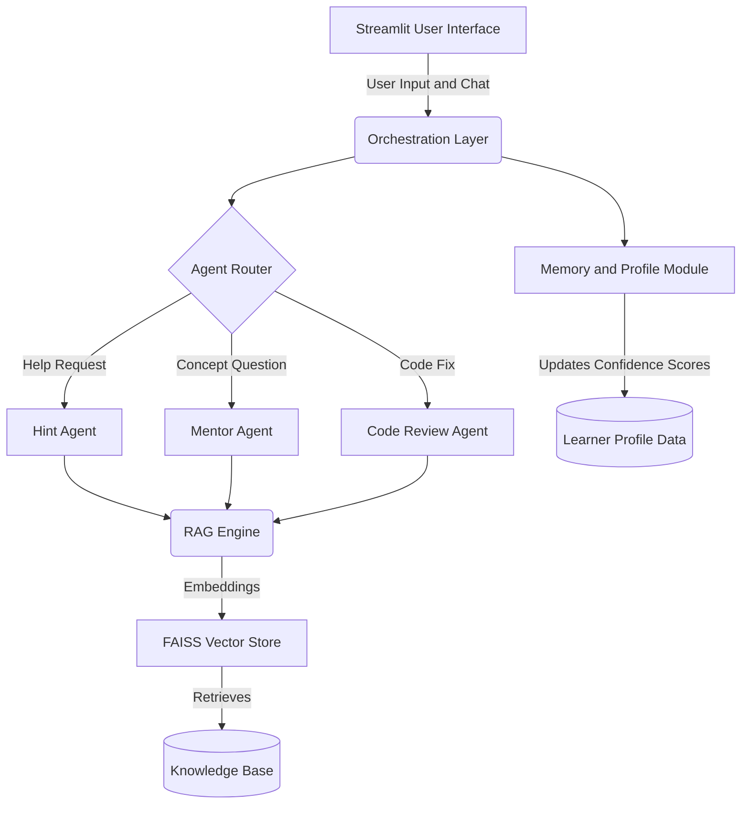
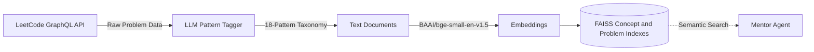
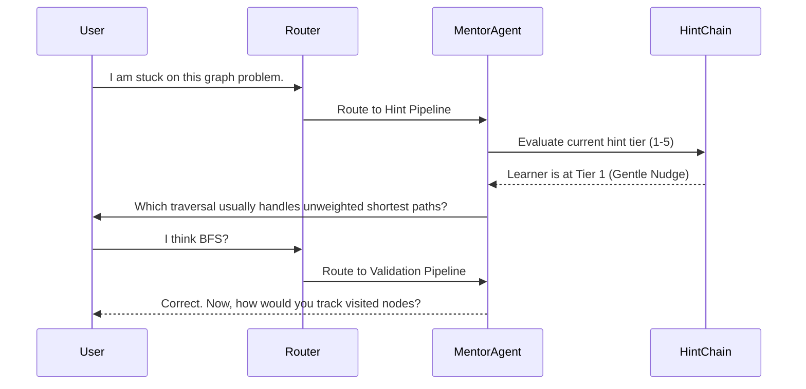

<div align="center">

# SahiiiDSA

### Learn. Think. Solve.

**An AI-powered Socratic tutoring platform for Data Structures and Algorithms**

K. K. Wagh Institute of Engineering Education & Research, Nashik
Project Review-I | Group No. 08 | Domain: Artificial Intelligence

**Under the guidance of Dr. S. N. Jagtap**

</div>

---
<div align="center">
## Project Team

| Sr. No. | Roll No. | Name |
|:-------:|:--------:|------|
| 01 | 03 | Isha Santosh Amodkar |
| 02 | 23 | Sayee Yogesh Gosavi |
| 03 | 26 | Mohit Ajay Jagtap |
| 04 | 45 | Sarvesh Suresh Patil |

<div>
---

## Overview

SahiiiDSA is an intelligent tutoring platform that teaches Data Structures and Algorithms (DSA) through guided questioning rather than ready-made answers. It does not generate solutions on request. It analyses a student's attempt, identifies where the reasoning breaks down, and responds with a progressive hint or a question that moves the student one step forward.

The platform is built on a Retrieval-Augmented Generation (RAG) pipeline and an agent-based architecture. It can run fully locally through Ollama, or through the Google Gemini API.

## The Problem

| Challenge | Description |
|-----------|-------------|
| Instant solution dependency | Students request AI-generated code immediately and skip the process of analysing the problem. |
| Superficial understanding | Understanding a given solution creates an illusion of learning; similar problems remain unsolved. |
| One-size-fits-all guidance | Existing platforms give generic hints that ignore individual progress and recurring mistakes. |
| Limited knowledge retention | Learning ends once the solution is obtained, with little reflection on the underlying concepts. |

## Objectives

1. Encourage guided problem solving
2. Develop independent problem-solving skills
3. Provide personalized learning support
4. Ensure accurate and reliable learning guidance
5. Support faculty with student learning insights

## Core Philosophy: The Socratic Method

Real learning comes from working through a problem and discovering the pattern, not from reading a finished solution. SahiiiDSA enforces this with a **five-tier hint system**: each request for help unlocks only the next level of guidance, starting with a gentle conceptual nudge and progressing gradually. The learner is asked the right question instead of being handed the answer.

## Methodology

SahiiiDSA follows a continuous learning cycle:

| Stage | Purpose |
|-------|---------|
| **Learn** | Understand the problem statement, constraints, and expected outcomes before writing code. |
| **Think** | Attempt the problem independently with guided questions and progressive hints. |
| **Solve** | Implement and submit; the system evaluates correctness, time and space complexity, and quality. |
| **Reflect** | Review the approach, identify key concepts, and understand why the solution works. |
| **Improve** | Track progress, detect recurring misconceptions, and personalize future practice. |

## Key Features

- **Socratic tutoring chat** with a five-tier hint progression
- **Personalized learning profile** with per-topic confidence tracking
- **Solution evaluation** covering correctness and basic time and space complexity
- **Misconception detection** to surface recurring reasoning errors
- **Retrieval-grounded guidance** from a curated DSA knowledge base to reduce hallucination
- **Faculty analytics** for monitoring progress and common misconceptions
- **Multi-language support** for Python, Java, and C++
- **Privacy-first operation** with local models and local embeddings

## Scope

| Area | Coverage |
|------|----------|
| Target users | Undergraduate engineering students, placement and interview candidates, and faculty |
| Initial topics | Arrays and Hashing |
| Content | Core concepts, common problem-solving patterns, and selected LeetCode problems |
| Languages | Python, Java, C++ |
| Assessment | Correctness evaluation, complexity analysis, progress tracking, misconception identification |

---

## System Architecture

### High-Level Design



### Knowledge Ingestion and Retrieval (RAG)



### Hint Enforcement Workflow



---

## Repository Structure

| Module | Responsibility |
|--------|----------------|
| `ingestion/` | Problem data collection, LLM-based pattern tagging, and learner profile generation |
| `rag/` | Local embeddings, FAISS indexing, and context retrieval |
| `agents/` | Router, five-tier hint chain, and the core mentor agent |
| `app.py` | Streamlit interface with progress tracking and radar-chart proficiency view |
| `scripts/` | Utilities for data ingestion and index building |

## Technology Stack

| Component | Technology |
|-----------|-----------|
| User interface | Streamlit with custom CSS |
| Language models | Ollama (local) or Google Gemini API |
| Embeddings | BAAI/bge-small-en-v1.5 (runs locally) |
| Vector database | FAISS (CPU) |
| Pipeline framework | LangChain |

---

## Getting Started

### Prerequisites

- Python 3.10 or higher
- Ollama installed and running (for local execution)
- A local model, for example:

```bash
ollama pull llama3.2
```

### Installation

```bash
# 1. Clone the repository
git clone <repository-url>
cd sahiiidsa

# 2. Create and activate a virtual environment
python -m venv venv
source venv/bin/activate        # Linux / macOS
# venv\Scripts\activate         # Windows

# 3. Install dependencies
pip install -r requirements.txt

# 4. Configure environment variables
cp .env.example .env
# Add your optional Gemini API key or LeetCode cookies in .env

# 5. Launch the application
streamlit run app.py
```

### Optional: Custom Data Ingestion

```bash
# Pull data directly from LeetCode
python scripts/ingest_leetcode.py --mode graphql --username YOUR_USERNAME

# Rebuild the offline vector indexes
python scripts/build_concept_index.py
python scripts/build_problem_index.py
```

---

## Expected Outcomes

- Reduced illusion of learning through guided, concept-first practice
- Stronger logical reasoning and independent problem solving
- Reliable, concept-focused guidance grounded in a curated knowledge base
- Early identification of learning gaps and recurring misconceptions
- Actionable learning insights for faculty
- Improved placement readiness in coding assessments and technical interviews

## Future Scope

- Expansion to additional DSA topics beyond Arrays and Hashing
- Voice-based tutoring and multimodal interaction
- Integration with external coding platforms and Learning Management Systems
- Collaborative learning and peer discussion
- Extension to subjects beyond the DSA curriculum
- Integrated in-app code editor (`streamlit-ace`)
- Stronger hallucination guards that validate code references against stored submissions
- Automatic cleanup of stale session vectors

## References

1. Lewis et al., *Retrieval-Augmented Generation for Knowledge-Intensive NLP Tasks*, 2020
2. Birillo et al., *One Step at a Time: Combining LLMs and Static Analysis to Generate Next-Step Hints for Programming Tasks*, 2024
3. Becker et al., *Programming is Hard - or at Least It Used to Be: Educational Opportunities and Challenges of AI Code Generation*, 2023
4. Alhafni et al., *LLMs in Education: Novel Perspectives, Challenges, and Opportunities*, 2024
5. Farrokhnia et al., *A SWOT Analysis of ChatGPT: Implications for Educational Practice and Research*, 2024

---

<div align="center">

**SahiiiDSA | Learn. Think. Solve.**

Group No. 08 | K. K. Wagh Institute of Engineering Education & Research, Nashik

</div>